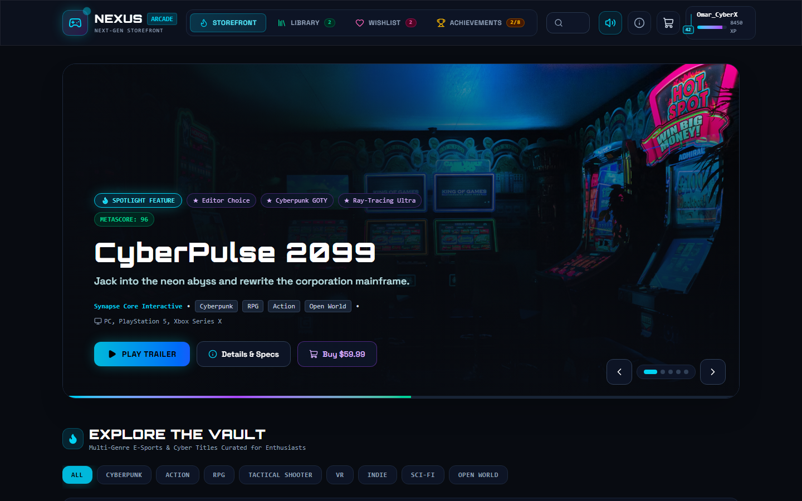
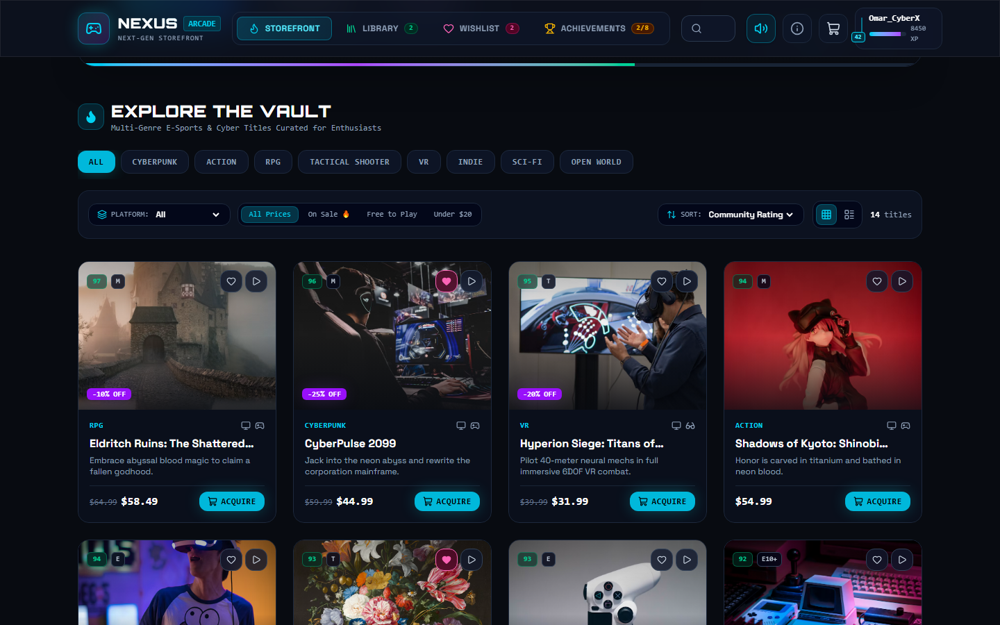
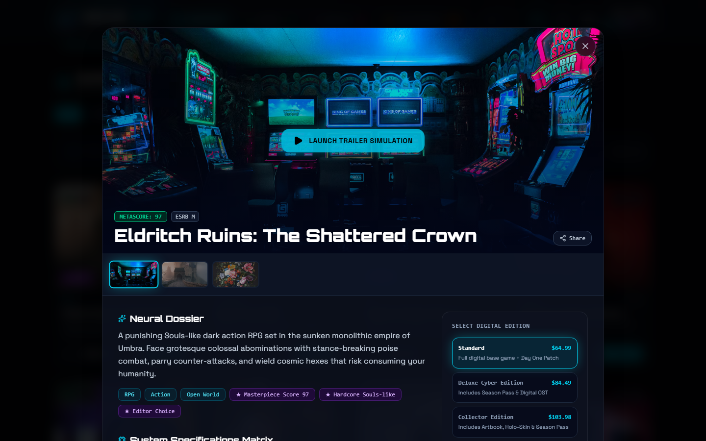
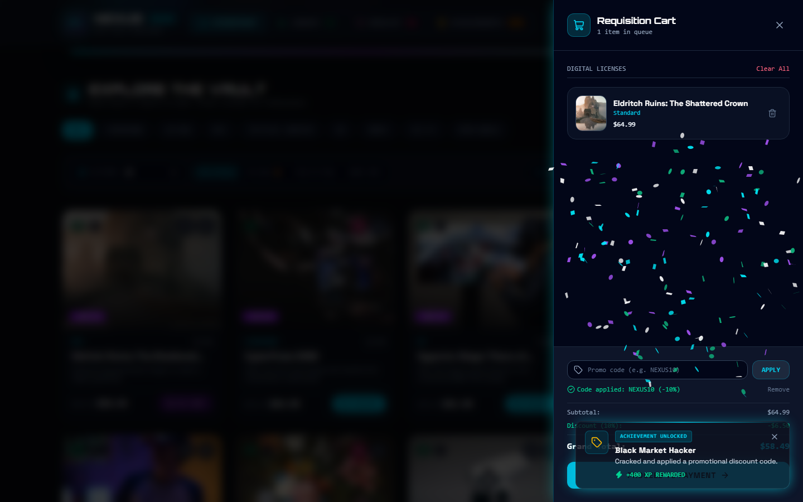
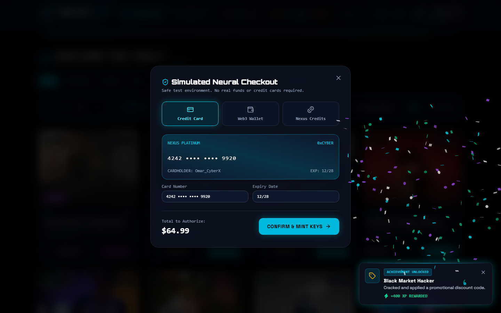
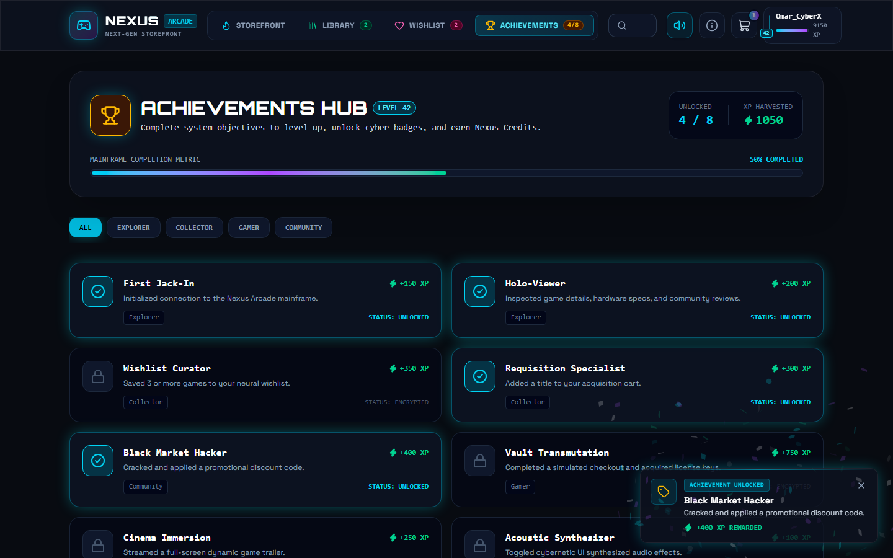
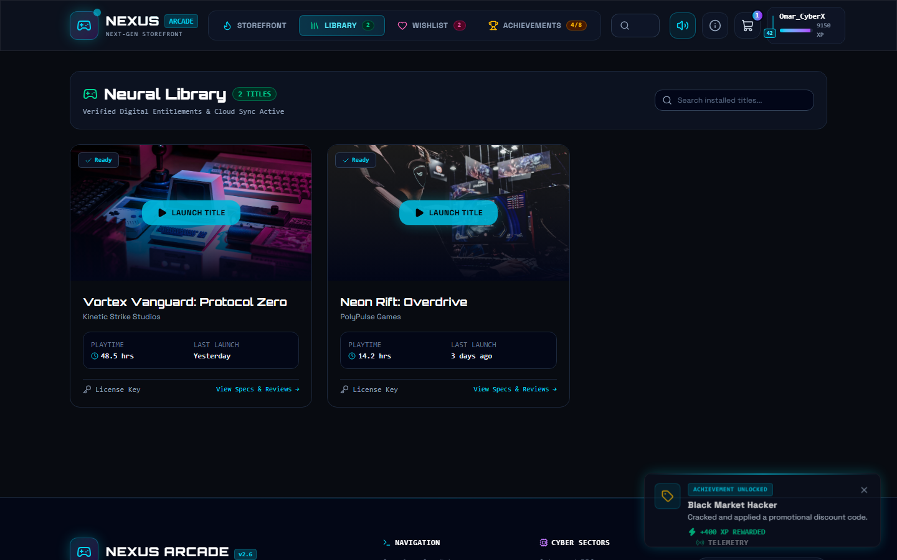
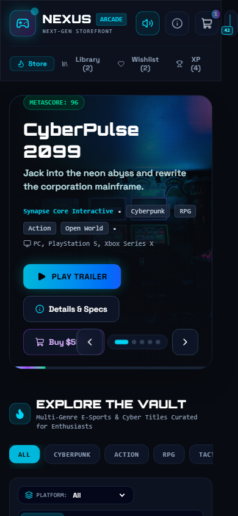

# 🎮 Nexus Arcade — Next-Gen E-Sports & Gaming Hub

[](https://react.dev/)
[](https://www.typescriptlang.org/)
[](https://vitejs.dev/)
[](https://tailwindcss.com/)
[](LICENSE)
[](https://omarkhlifi.com)
[](https://pages.github.com/)

> **Nexus Arcade** is a responsive, client-side single-page gaming hub and digital storefront application. Engineered with a dark cyber/e-sports aesthetic (slate/zinc neutrals, neon cyan/purple/emerald accents, glassmorphism, and responsive feedback), it provides a complete storefront experience—with zero backend dependencies—so it can be deployed directly to **GitHub Pages**.

---

## 👨‍💻 Author & Attribution

- **Project Lead & Frontend Architect**: [Omar Khlifi](https://omarkhlifi.com)
- **Portfolio**: [omarkhlifi.com](https://omarkhlifi.com)
- **GitHub**: [@omarkhlifi](https://github.com/omarkhlifi)
- **LinkedIn**: [linkedin.com/in/omarkhlifi](https://linkedin.com/in/omarkhlifi)
- **License**: MIT (100% original modular codebase, suitable for portfolio showcase)

---

## 📸 Visual Showcase & Screenshots

All high-resolution previews below are located in the [`screenshots/`](./screenshots) directory:

### 1. Spotlight Hero Showcase & Cyber Navigation
Dynamic carousel featuring auto-play with progress bar, genre badges, Metacritic score pill, and quick "Play Trailer" and "Inspect Details" CTAs.


---

### 2. Multi-Filter Catalog & Cyber Game Grid
Live debounced search, genre category pills (Cyberpunk, Action, RPG, Tactical Shooter, VR, Indie, Sci-Fi), platform filters (PC, PS5, Xbox Series X, VR), price filters, and sorting matrix.


---

### 3. Interactive Game Detail Drawer & Hardware Specs
Full-width hero media gallery, minimum vs. recommended PC hardware specifications matrix, verified player reviews, edition selector, and direct acquisition CTAs.


---

### 4. Slide-Over Cart & Promo Code Applicator
Slide-over drawer with itemized pricing, promo code applicator (`NEXUS10`, `CYBER25`, `OMARVIP`), and real-time discount calculations.


---

### 5. Simulated Neural Checkout & Virtual Credit Card
Multi-method payment simulation supporting holographic Cyber Platinum Card, Web3 / Crypto Wallets (MetaMask, Phantom), and Nexus Credits with instant digital CD key minting.


---

### 6. Gamified Achievement Matrix & XP Progress Hub
Interactive tracker with 8 distinct achievements, XP reward multipliers, level progress bar, and celebratory toast notifications with audio feedback.


---

### 7. Digital Library & Cloud Play Simulator
Personal vault containing owned games, simulated launch state with active session indicator, playtime counters, and digital license key copy action.


---

### 8. Mobile Responsive Design
Optimized touch targets, collapsible mobile navigation bar, and responsive glassmorphic cards.
<p align="center">
  
</p>

---

## ⚡ Core Features & User Journeys

### 1. Hero Showcase / Spotlight Carousel
- Dynamic autoplaying featured carousel highlighting flagship titles.
- Smooth slide transitions with manual controls and animated timer bar.
- Direct access to trailer cinema and game specifications.

### 2. Multi-Filter Catalog System
- **Genre Filtering**: All, Cyberpunk, Action, RPG, Tactical Shooter, VR, Indie, Sci-Fi, Open World.
- **Platform Selector**: PC, PlayStation 5, Xbox Series X, VR.
- **Price Filters**: All, On Sale 🔥, Free to Play, Under $20.
- **Sort Options**: Community Rating, Release Date, Title (A-Z), Price: Low to High, Price: High to Low.
- **Layout Switcher**: Toggle between 4-column **Grid View** and compact **List View**.
- **Live Search**: Instant debounced search bar with animated dropdown preview.

### 3. Deep-Dive Game Detail Drawer
- **Media Gallery**: High-res screenshots carousel and 4K trailer simulation launcher.
- **Hardware Specs Matrix**: Side-by-side comparison of **Minimum** vs. **Recommended (60+ FPS Ultra)** specs (OS, CPU, GPU, RAM, Storage).
- **Player Reviews**: Star distribution, verified purchase badges, and form to submit real-time player reviews (+50 XP).
- **Edition Selection**: Choose between *Standard*, *Deluxe Cyber Edition*, or *Collector Edition*.

### 4. Cybernetic Web Audio Synthesizer
- Built using the native HTML5 **Web Audio API** (oscillator and gain nodes) without relying on external MP3 assets.
- Produces authentic retro-futuristic audio feedback:
  * Subtle hover chirps
  * Tactical click blips
  * Achievement fanfare arpeggios
  * Requisition purchase chimes
- Persistent mute/unmute toggle in header navigation.

### 5. Gamified Profile & Achievement Engine
- **Gamer Profile**: GamerTag (editable), Level, XP progress bar, Nexus Credits balance, and Web3 wallet address.
- **Service Medals & Badges**: Rarity tiers (Common, Rare, Epic, Legendary).
- **8 Unlockable Achievements**:
  * `First Jack-In`: Initialize connection (+150 XP)
  * `Holo-Viewer`: Inspect game details & hardware specs (+200 XP)
  * `Wishlist Curator`: Save 3+ games to wishlist (+350 XP)
  * `Requisition Specialist`: Add game to cart (+300 XP)
  * `Black Market Hacker`: Apply promo discount code (+400 XP)
  * `Vault Transmutation`: Complete simulated checkout (+750 XP)
  * `Cinema Immersion`: Stream full-screen trailer (+250 XP)
  * `Acoustic Synthesizer`: Toggle cyber audio FX (+100 XP)
- Confetti celebration and animated HUD toast notifications.

### 6. Digital Library & License Key Generator
- Cryptographic-style license key generation (`NX-XXXX-XXXX-XXXX`) upon checkout.
- Simulated game launch with session state feedback.
- One-click license key clipboard copy.

---

## 🛠️ Technology Stack & Architecture

| Layer | Technology | Rationale |
| :--- | :--- | :--- |
| **Framework** | [React 19](https://react.dev/) + [TypeScript](https://www.typescriptlang.org/) | Type-safe UI components and modern React hooks |
| **Build Tool** | [Vite 6](https://vitejs.dev/) | Sub-second HMR and optimized production bundling |
| **Styling** | [Tailwind CSS v4](https://tailwindcss.com/) | Modern utility-first engine with `@theme` token definitions |
| **Icons** | [Lucide React](https://lucide.dev/) | Clean, scalable cybernetic icons |
| **Animation** | [Framer Motion](https://www.framer.com/motion/) | Fluid modal slide-overs, card staggers, and layout animations |
| **FX & Audio** | Native Web Audio API + Canvas Confetti | Procedural sound synthesis and celebratory particles |
| **State & Storage** | React Context + `localStorage` | Fully client-side persistent library, cart, and profile state |

---

## 📂 File & Folder Structure

```text
nexus-arcade/
├── public/
│   └── favicon.svg              # Custom cyber gamepad SVG favicon
├── screenshots/                 # High-resolution application screenshots
│   ├── 01-hero-showcase.png
│   ├── 02-catalog-filters.png
│   ├── 03-game-detail-modal.png
│   ├── 04-cart-drawer.png
│   ├── 05-checkout-modal.png
│   ├── 06-achievements-hub.png
│   ├── 07-my-library.png
│   └── 08-mobile-responsive.png
├── scripts/
│   └── capture-screenshots.js   # Automated Puppeteer screenshot pipeline
├── src/
│   ├── components/
│   │   ├── AboutModal.tsx       # Author attribution and MIT license details
│   │   ├── AchievementToast.tsx # HUD notification toast for unlocked achievements
│   │   ├── AchievementsView.tsx # Gamified achievements overview and XP progress
│   │   ├── BrandIcons.tsx       # Scalable SVG brand icons (GitHub, LinkedIn)
│   │   ├── CartDrawer.tsx       # Slide-over cart with promo code calculator
│   │   ├── CheckoutModal.tsx    # Mock payment processor and license key minting
│   │   ├── FilterBar.tsx        # Multi-genre chips, platform, price, and sort filters
│   │   ├── Footer.tsx           # Cyber telemetry, quick navigation, and copyright
│   │   ├── GameCard.tsx         # Responsive game card with score and platform badges
│   │   ├── GameDetailDrawer.tsx # Deep-dive drawer with hardware specs and reviews
│   │   ├── GameGrid.tsx         # Staggered game catalog grid with empty state fallback
│   │   ├── HeroBanner.tsx       # Spotlight carousel with autoplay and CTAs
│   │   ├── LibraryView.tsx      # User's digital game library and launch simulation
│   │   ├── Navbar.tsx           # Navigation bar with live search dropdown
│   │   ├── ProfileDrawer.tsx    # Gamified profile, medals, and achievement tracker
│   │   ├── TrailerModal.tsx     # Fullscreen video cinema player
│   │   └── WishlistView.tsx     # Wishlist manager with quick cart transfer
│   ├── context/
│   │   ├── GameContext.tsx      # Catalog, filters, cart, wishlist, and library state
│   │   └── UserContext.tsx      # Profile, achievements, XP progression, and audio
│   ├── data/
│   │   └── mockGames.ts         # 14+ fictional game titles with Unsplash artwork
│   ├── hooks/
│   │   ├── useLocalStorage.ts   # Generic persistent storage synchronization hook
│   │   └── useSoundEffects.ts   # Web Audio API procedural cyber sounds synthesizer
│   ├── types/
│   │   └── index.ts             # Comprehensive TypeScript interface definitions
│   ├── App.tsx                  # Main layout orchestrator
│   ├── index.css                # Tailwind v4 theme, cyber glows, and scanlines
│   └── main.tsx                 # React DOM mount point
├── index.html                   # HTML entrypoint with Orbitron & Rajdhani fonts
├── package.json                 # Project dependencies and npm scripts
├── tsconfig.json                # TypeScript root configuration
├── tsconfig.app.json            # Application TypeScript configuration
└── vite.config.ts               # Vite configuration with relative paths (base: './')
```

---

## 🚀 Quick Start & Local Development

### Prerequisites
- [Node.js](https://nodejs.org/) (v18 or higher recommended)
- `npm` (v9 or higher)

### Installation
```bash
# Clone repository
git clone https://github.com/omarkhlifi/nexus-arcade.git

# Enter project directory
cd nexus-arcade

# Install dependencies
npm install

# Start local development server
npm run dev
```
Open [http://localhost:5173](http://localhost:5173) in your browser.

### Building for Production
```bash
npm run build
```
The compiled, production-ready static assets will be output to the `dist/` directory with relative asset paths configured for direct GitHub Pages deployment.

### Previewing the Production Build
```bash
npm run preview
```

---

## 🌐 Deploying to GitHub Pages

Because **Nexus Arcade** uses relative static paths (`base: './'` in `vite.config.ts`), deployment to GitHub Pages requires no backend setup:

### Method 1: Using `gh-pages` (Recommended)
```bash
# Install gh-pages
npm install -D gh-pages

# Add deployment scripts to package.json:
# "predeploy": "npm run build",
# "deploy": "gh-pages -d dist"

# Deploy to GitHub Pages
npm run deploy
```

### Method 2: GitHub Actions Workflow
Create `.github/workflows/deploy.yml`:
```yaml
name: Deploy to GitHub Pages

on:
  push:
    branches: [main]

permissions:
  contents: read
  pages: write
  id-token: write

concurrency:
  group: 'pages'
  cancel-in-progress: true

jobs:
  deploy:
    environment:
      name: github-pages
      url: ${{ steps.deployment.outputs.page_url }}
    runs-on: ubuntu-latest
    steps:
      - name: Checkout repository
        uses: actions/checkout@v4

      - name: Setup Node.js
        uses: actions/setup-node@v4
        with:
          node-version: 20
          cache: 'npm'

      - name: Install dependencies
        run: npm ci

      - name: Build application
        run: npm run build

      - name: Setup Pages
        uses: actions/configure-pages@v4

      - name: Upload artifact
        uses: actions/upload-pages-artifact@v3
        with:
          path: './dist'

      - name: Deploy to GitHub Pages
        id: deployment
        uses: actions/deploy-pages@v4
```

---

## 📜 License

This project is licensed under the **MIT License** — you are completely free to use, customize, and showcase this project for portfolio, educational, and commercial purposes.

```text
MIT License

Copyright (c) 2026 Omar Khlifi

Permission is hereby granted, free of charge, to any person obtaining a copy
of this software and associated documentation files (the "Software"), to deal
in the Software without restriction, including without limitation the rights
to use, copy, modify, merge, publish, distribute, sublicense, and/or sell
copies of the Software, and to permit persons to whom the Software is
furnished to do so, subject to the following conditions:

The above copyright notice and this permission notice shall be included in all
copies or substantial portions of the Software.

THE SOFTWARE IS PROVIDED "AS IS", WITHOUT WARRANTY OF ANY KIND, EXPRESS OR
IMPLIED, INCLUDING BUT NOT LIMITED TO THE WARRANTIES OF MERCHANTABILITY,
FITNESS FOR A PARTICULAR PURPOSE AND NONINFRINGEMENT.
```
